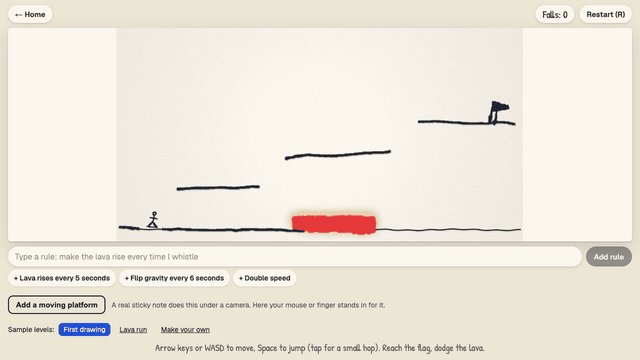

# Paper Worlds

Draw a game on paper. Play it a few seconds later.



**Play it now: https://paper-worlds-flame.vercel.app**

Press Try it now. You don't need paper or a camera or an account.

I built this for the Meta Global AI Developer Hackathon (Indie Developer track) with Muse Spark, SAM 3.1, Muse Wonder and Muse Voice Transcribe.

## What it does

You draw a level with a pen. Dark lines are platforms and red is lava. Add a stick figure and a flag, then take a photo. Your own strokes become the level and your stick figure becomes the hero.

Then the paper keeps working while you play.

- **Sticky notes are live platforms.** Put a bright note under the camera and it turns into a platform that follows your hand. Move it to catch yourself.
- **Rules change the game.** Type or say something like "make the lava rise every time I whistle" and it happens.

Try it now has two of my drawings ready to go. Your mouse or finger stands in for the sticky note there and that works from a laptop or a phone.

## How it works

| Step | What does it |
|---|---|
| Read the drawing | The app flattens the photo in the browser. **Muse Spark** labels each mark as a platform, lava, the flag or the stick figure. The app then fits those labels to the real ink and platforms land exactly where you drew them. |
| Find sticky notes | **SAM 3.1** finds the notes on a camera frame and the app learns each note's color from that same frame. |
| Follow sticky notes | A small color tracker runs in the browser on every frame and that keeps a moving note feeling instant. SAM checks the tracker every few seconds and steps in right away when a note gets lost. |
| Turn a sentence into a rule | **Muse Wonder** compiles your words into a small safe rule with structured output. If you ask for something the game can't do, it says so and suggests something it can. |
| Hear a spoken rule | **Muse Voice Transcribe** turns your voice into text and Wonder takes it from there. |
| Whistle and double clap | These are detected in the browser, since they're sounds and not words. |

The game itself runs on Phaser. A level is checked before you play and if the flag is out of reach the jump gets tuned so you can actually win.

## Built during the hackathon

Everything in this repo was written during the hackathon window (Oct 27 to Nov 4, 2026). The git history starts on Nov 1, 2026.

## Run it yourself

You need a Meta Model API key.

```
cp .env.example .env.local   # add your MODEL_API_KEY
npm install
npm run dev
```

`npm test` runs the unit tests. The browser tests are in `tests/e2e` and run with `npx playwright test tests/e2e`. They need a local server on port 3111 or a `BASE_URL` and the checks in `checks.spec.ts` need a dev server and `--workers=1`.

For the sticky notes use Safari if you want your iPhone as the camera, since Chrome didn't list it when I tested. Blue and green notes work best.

## Credits

- The drawings in `public/samples` are mine.
- Libraries: Next.js (MIT), React (MIT), Phaser (MIT), zod (MIT) and the OpenAI SDK (Apache 2.0), which talks to Meta's API.
- Fonts: Geist and Patrick Hand from Google Fonts.
- Sound effects in the demo video come from Pixabay under the Pixabay Content License: UI Success Chime and Sci-Fi UI Click Sound by SoundShelfStudio and Thin Swoosh by Universfield. The music was made in code for this video.

## License

MIT. See `LICENSE`.
